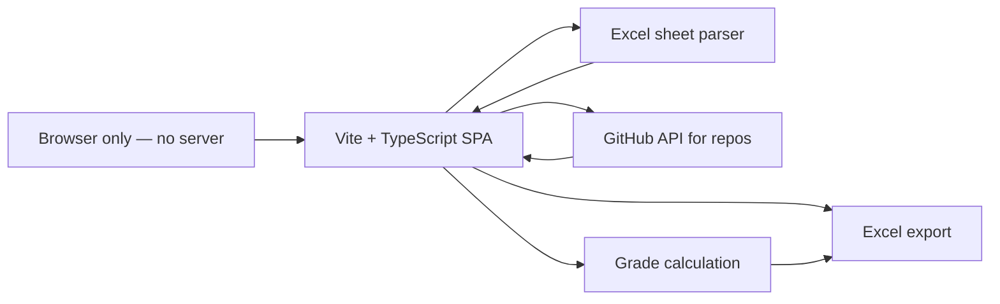

# Sir ar Last Date

A submission register and gradebook that runs in your browser. Upload an Excel
sheet, set a deadline, and the page tells you who pushed in time, who did not,
which files changed, and which repos hold identical files or share code. It can
also mark grades for you, with auto deductions for late or changed-after-
deadline work and a bonus box per student for marks given while asking
questions.

## Architecture / How it Works




- **No login.** The sheet is read in this browser. Names and IDs are never
  sent to a server.
- **Two kinds of sheets** — the app auto-detects which one you uploaded.
  - **Project base**: an `id`, a `name`, and a `repolink` column. Every
    student's GitHub repo is checked against the deadline.
  - **Performance base**: `id`, `name`, and any number of mark columns.
    Set a **total mark**, a **late deduction**, and a **changed-after
    deduction**; the final mark and the deduction breakdown show on screen
    and in the downloaded file.
- **Deadline in one place.** Type it once; the register sorts, the person
  page draws it across the timeline, and the file's Info sheet records it.
- **Contribution tab.** For a project sheet: who committed to each repo and
- **Similarity tab.** Repos that hold identical files, and who had them on
  GitHub first. Below that, **shared code**: repos that share code even
  where a copy was edited (spaces, line endings, case, comments or some
  lines changed), with links to the shared lines on both sides. Places to
  look, not a verdict.
  how large each person's share of the commits is, counted the same way as
  the report's "Commits by person" column. A repo handed in by several people
  is shown once, with all of them.
- **Reports as `.xlsx`.** Results, Summary, Needs attention, Same repo,
  Info. The same colours as the page, the same dates as the page.

For the long version — every column, every status, every rule, the build,
the API, the limits — see [docs/SHEETS.md](docs/SHEETS.md). For how the
mark deduction works, see [docs/GRADING.md](docs/GRADING.md).

## Run it on your computer

Needs Node 22.22 or newer (`.nvmrc` says 22).

```sh
npm install
cp .dev.vars.example .dev.vars   # then put your GitHub token in it
npm run dev                      # http://localhost:5173
```

The token must be a **fine-grained** GitHub token with **Public repositories**
access and **no permissions**. Create one at
<https://github.com/settings/personal-access-tokens/new>. It can read nothing
private. `.dev.vars` is ignored by git; never commit a token.

```sh
npm test           # unit and screen tests
npm run coverage   # the same, with a coverage report in coverage/
npm run lint       # oxlint
npm run build      # type-check and build
```

GitHub Actions runs lint, tests and build on every push to `main` and every
pull request (`.github/workflows/ci.yml`). After a push to `main` it also
puts the app online, but only when all three passed (see
[docs/SHEETS.md](docs/SHEETS.md#put-it-online-cloudflare-workers-free-plan)).

## What to read next

- [docs/SHEETS.md](docs/SHEETS.md) — the full feature reference: the project
  register, the performance register, the similarity check, the API, the
  limits, the build.
- [docs/GRADING.md](docs/GRADING.md) — the auto-deduction rules, with three
  worked examples.

## License

This project keeps to the same license as the existing repository.
